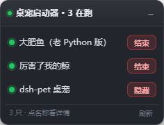

# dsh-pet-launcher

**DSH（DeepSeek Harness）桌面端界面左下角的一块小浮窗：每只桌宠一行，一个按钮起/停。**

_A tiny floating panel for the DSH desktop app: one row per desktop pet, one button to start/stop it._



- 宿主机半侧：`lib/index.js`（注入行 + 4 条 HTTP 路由 + spawn）
- 页面半侧：`lib/widget.js`（注入到界面的浮窗）
- 宠物定义：`pets.json` —— **唯一真相源**，加减宠物只改这里，改完刷新面板即可，不用重装或重启

## 安装

把本仓库拷到任意位置（路径别带符号链接），然后 link 安装 —— 这样改代码即时生效：

```powershell
# 先把示例配置复制成你的真实配置
Copy-Item pets.example.json pets.json

# link 安装到 desktop profile（<本仓库绝对路径> 换成实际路径）
dsh plugin --profile desktop add link:"<本仓库绝对路径>"
```

装完要看到面板得**托盘退出 DSH 再打开** —— 注入表是宿主启动时一次性收集的。

卸载：

```powershell
dsh plugin --profile desktop remove dsh-pet-launcher
```

## 路由

| 方法 | 路径 | 说明 |
|---|---|---|
| GET | `/pet-launcher/widget.js` | 浮窗脚本（按 mtime 缓存，`no-store`） |
| GET | `/pet-launcher/status` | `{ok,pets:[{id,label,enabled,kind,mode,running,pid,display,helperRunning,error}]}` |
| POST | `/pet-launcher/start?id=<id>` | 启动 / 显示；已在跑返回 `{ok,already:true,pid}` |
| POST | `/pet-launcher/stop?id=<id>` | 结束 / 隐藏；本来就没跑返回 `{ok,already:true}` |

端口一律取 `ctx.webServer.port`，从不写死（宿主每次启动端口都会变）。

## `pets.json` 字段

| 字段 | 适用 kind | 说明 |
|---|---|---|
| `id` | 全部 | 唯一标识，路由参数用它 |
| `label` | 全部 | 面板上显示的名字 |
| `enabled` | 全部 | `false` → 按钮灰显「已禁用」 |
| `kind` | 全部 | `exe`（直接 spawn）/ `cmd`（`cmd /c` 走批处理）/ `dshpet`（插件持有，只能显示/隐藏） |
| `target` / `args` / `cwd` | `exe`、`cmd` | 可执行文件 / 参数 / 工作目录（绝对路径） |
| `detect.imageName` | `exe`、`cmd` | 用来判断"是否在跑"的镜像名（`pythonw.exe` 这种） |
| `detect.imagePath` | `exe`、`cmd` | 镜像**完整路径**；同名的 `pythonw.exe` 可能有多个实例，只看镜像名会认错、误杀 |
| `configFile` | `dshpet` | dsh-pet 的用户配置（JSONC，带注释，读之前要剥） |
| `apiBase` | `dshpet` | dsh-pet 路由前缀，默认 `/dsh-pet-7340` |
| `helperPath` | `dshpet` | 桌面 helper（`~/.dsh/electron/electron.exe`），只做只读探针 |
| `hideOnHostStart` | `dshpet` | `true` = **每次 DSH 启动都把它收回 `none`**（不随 DSH 自启） |
| `killOnHostExit` | `exe`、`cmd` | 默认 `true` = **关 DSH 时把这只一起收掉**；`false` 就让它继续留在桌面上 |

## 几个不显然的设计

### 写接口只认本机回环

这接口能**起任意进程**，所以 POST 必须同时满足：`Host` 是 `localhost` / `127.x` / `::1`；不是 `Sec-Fetch-Site: cross-site`；带了 `Origin` 就必须与 `Host` 同源。任一不满足 → 403。宿主自己的栅栏（`connection.requestRejection`）抛异常时同样 **fail-closed** 到 403。

> `Host: 127.0.0.1.evil.com` 这种相似域名会被按「完整 label 比对」拒掉，不是 `startsWith`。

### 关 DSH = 关桌宠（`killOnHostExit`）

插件被 dispose（宿主退出）时**同步**收掉 spawn 型的宠物：一次 PowerShell 扫全镜像 → 按「镜像名 + 完整路径」认领 → `process.kill` → 还活着的用 `taskkill /T /F` 补刀。
必须同步：dispose 之后进程马上就走，异步的 `setTimeout`/`await` 来不及。

`kind: "dshpet"` 那只**不**在这里同步杀 —— 实测 dsh-pet 会把被杀掉的 helper 自己拉回来（8 秒内换新 pid），同步杀只会和它的重启逻辑打架。正确做法是让 dsh-pet 自己的 dispose 处理，本插件只挂一个**兜底**：detached 起一个 PowerShell，3 秒后如果宿主进程已经不在、helper 还赖着，才 `taskkill /T /F`。

### `kind: "cmd"` 的坑

`start "" my-pet.exe` 这种批处理里，**cmd 会立刻退出**，真身是它 start 出去的 exe。所以"是否在跑"不能靠 `child.pid` 探活，必须靠 `detect` 扫进程认领；「结束」时也要先按镜像名 + 完整路径双重比对，才敢动手。

### `kind: "dshpet"` 的语义是显示 / 隐藏

那只不是独立 exe —— 桌面窗口由 dsh-pet 插件自己拉起的 Electron helper 承载。所以按钮语义是：

1. 读 `configFile`（JSONC，剥注释再 parse；解析失败按"未知"处理，界面显示红点 + 错误文本，**绝不瞎改**）
2. 取 `pets[0].display`，在 `desktop` ↔ `none` 之间翻转
3. `PUT http://127.0.0.1:${ctx.webServer.port}${apiBase}/config`，body = 改过 display 的整份配置 → dsh-pet 写回用户配置并 `syncDesktop()`，**不用重启 DSH**

`hideOnHostStart: true` 时，插件在自己的 `apply()`（= 宿主启动）里检查一次：已经是 `none` 就什么都不做；还是 `desktop`/`both` 就 PUT 回 `none`（带 0/0.7/1.8/3.5/7/12 秒重试，覆盖"本插件比 dsh-pet 先加载"那段空窗）。好处是**不是藏窗口而是根本不启动**：`display` 为 `none` 时 dsh-pet 连 Electron helper 都不会拉起。

## 测试

```bash
npm test        # = node test/routes.mjs
```

23 项，不安装、不启动任何桌宠：把 `apply()` 挂到 **mock 宿主**上，验证注入行、4 条路由、5 种安全栅栏、参数校验（400/404/405）、JSONC 解析、路径归一化。只用 node 内置模块。

## 已知边界

- 宿主**崩溃**退出（任务管理器杀掉 / 蓝屏）时 dispose 钩子不会跑，桌宠会留在桌面上；再开 DSH 点「结束」即可。
- 进程状态靠 10 秒 TTL 的扫描缓存；起停之后会主动失效缓存（踩过"杀完仍显示在跑"）。

## 授权

MIT。
